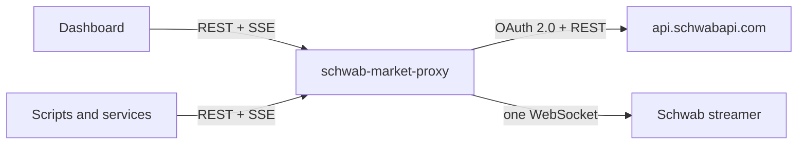

# schwab-market-proxy

[](LICENSE)
[](package.json)

A self-hosted proxy for the [Schwab Trader API](https://developer.schwab.com). It turns one
authenticated Schwab session into a local market-data service: a REST passthrough, a single
streaming connection shared over Server-Sent Events, and a browser dashboard for quotes and
option chains.

> [!NOTE]
> Not affiliated with or endorsed by Charles Schwab. You need your own Schwab developer app,
> and use is subject to Schwab's API terms and your market-data agreements.

## Features

- **OAuth on Schwab's login page.** The proxy never sees your password, and access tokens
  refresh automatically.
- **One upstream stream, many clients.** All consumers share a single streamer WebSocket.
  Subscriptions are reference-counted, and new clients receive the latest values immediately.
- **Read-only by design.** Only `/marketdata/v1` is exposed. Trading and account endpoints
  are not reachable through the proxy.
- **Dashboard.** Live watchlist and an options chain with streaming bid, ask, IV and delta.
- **No dependencies.** Plain Node.js using the built-in `fetch`, `WebSocket` and `http`.

## How it works



## Requirements

- Node.js 22.4 or later.
- A Schwab developer app in **Ready For Use** status with the *Market Data Production* and
  *Accounts and Trading Production* APIs. The second provides `userPreference`, which
  supplies the streamer connection details; no trading endpoint is ever called.

## Quick start

1. Register an app at [developer.schwab.com](https://developer.schwab.com) with the callback
   URL `https://127.0.0.1:8182`.
2. Configure and start the proxy:

   ```bash
   git clone https://github.com/cpatil/schwab-market-proxy.git
   cd schwab-market-proxy
   cp .env.example .env    # set SCHWAB_CLIENT_ID and SCHWAB_CLIENT_SECRET
   npm start
   ```

3. Open <http://127.0.0.1:8787> and select **Open Schwab login**. After you approve access,
   Schwab redirects to the callback URL, which does not load. Paste that full address into
   the dashboard and select **Finish login**.

Schwab requires an interactive login every 7 days. See [Authentication](docs/authentication.md).

## Configuration

Settings are read from environment variables or `.env`.

| Variable | Default | Description |
| --- | --- | --- |
| `SCHWAB_CLIENT_ID` | | App client ID from the developer portal. |
| `SCHWAB_CLIENT_SECRET` | | App client secret. |
| `SCHWAB_CALLBACK_URL` | `https://127.0.0.1:8182` | Must match the registered callback exactly. |
| `PORT` | `8787` | HTTP port. |
| `BIND_HOST` | `127.0.0.1` | Listen address. Use `0.0.0.0` to serve other machines. |
| `ALLOWED_HOSTS` | | Additional host names or IPs, without port, that clients may use. |
| `CORS_ORIGINS` | | Other browser origins allowed to read the API. |
| `TOKEN_FILE` | `data/tokens.json` | Token store, created with mode `0600`. |

## API

| Endpoint | Description |
| --- | --- |
| `GET /api/stream?service={service}&keys={keys}` | Live data as Server-Sent Events. |
| `GET /api/marketdata/{path}` | Passthrough to `/marketdata/v1/{path}`: `quotes`, `{symbol}/quotes`, `pricehistory`, `chains`, `expirationchain`, `movers/{index}`, `markets`, `instruments`. |
| `GET /api/fields` | Field names for each streamer service. |
| `GET /api/status` | Authentication and streamer state. |

Streamer services: `LEVELONE_EQUITIES`, `LEVELONE_OPTIONS`, `LEVELONE_FUTURES`,
`LEVELONE_FUTURES_OPTIONS`, `LEVELONE_FOREX`, `CHART_EQUITY`, `CHART_FUTURES`, `NYSE_BOOK`,
`NASDAQ_BOOK`, `OPTIONS_BOOK`, `SCREENER_EQUITY`, `SCREENER_OPTION`.

Each `data` event carries the merged latest fields for one key. `changed` lists the fields
updated by that event, and `timestamp` is `null` when cached values are replayed to a new
client. `status` events report the streamer state: `idle`, `connecting`, `ready`,
`reconnecting` or `waiting_for_login`. A keep-alive comment is sent every 15 seconds.

```text
event: data
data: {"service":"LEVELONE_EQUITIES","key":"AAPL","timestamp":1792452005886,"fields":{"BID_PRICE":342.77,"ASK_PRICE":342.95},"changed":["ASK_PRICE"]}
```

```bash
# Stream quotes
curl -N 'http://127.0.0.1:8787/api/stream?service=LEVELONE_EQUITIES&keys=AAPL,SPY'

# One expiration of an option chain
curl -s 'http://127.0.0.1:8787/api/marketdata/chains?symbol=SPY&fromDate=2026-11-20&toDate=2026-11-20&strikeCount=10'
```

Option contracts stream under `LEVELONE_OPTIONS` using each contract's `symbol` from the
chain. These symbols contain spaces, so URL-encode them (`SPY%20%20%20261120C00770000`).
Encode `/` in futures symbols as `%2F` in REST paths.

## Security

- Binds to `127.0.0.1` by default. Requests must address `127.0.0.1`, `localhost`, `[::1]`
  or an `ALLOWED_HOSTS` name on the configured port; others are rejected, which blocks
  DNS rebinding.
- Login and logout are accepted only from the dashboard's own origin.
- Tokens and the client secret are never returned by the API.
- When the proxy is reachable beyond loopback, anyone who can reach the port can read market
  data and log the proxy in or out. Expose it only to trusted networks.

To report a vulnerability, see [SECURITY.md](SECURITY.md).

## Deployment

The proxy runs well as a systemd user service on an always-on host. See
[Deployment](docs/deployment.md).

## Limitations

- No news: the public Trader API has no news endpoint or streamer service.
- Account and trading data are out of scope.
- The 7-day re-authentication is a Schwab requirement and cannot be automated.

## Contributing

See [CONTRIBUTING.md](CONTRIBUTING.md). Run the tests with `npm test`; they use fakes and
need no Schwab account.

## License

[MIT](LICENSE). Streamer field numbering was cross-checked against
[schwab-py](https://github.com/alexgolec/schwab-py) (MIT).
